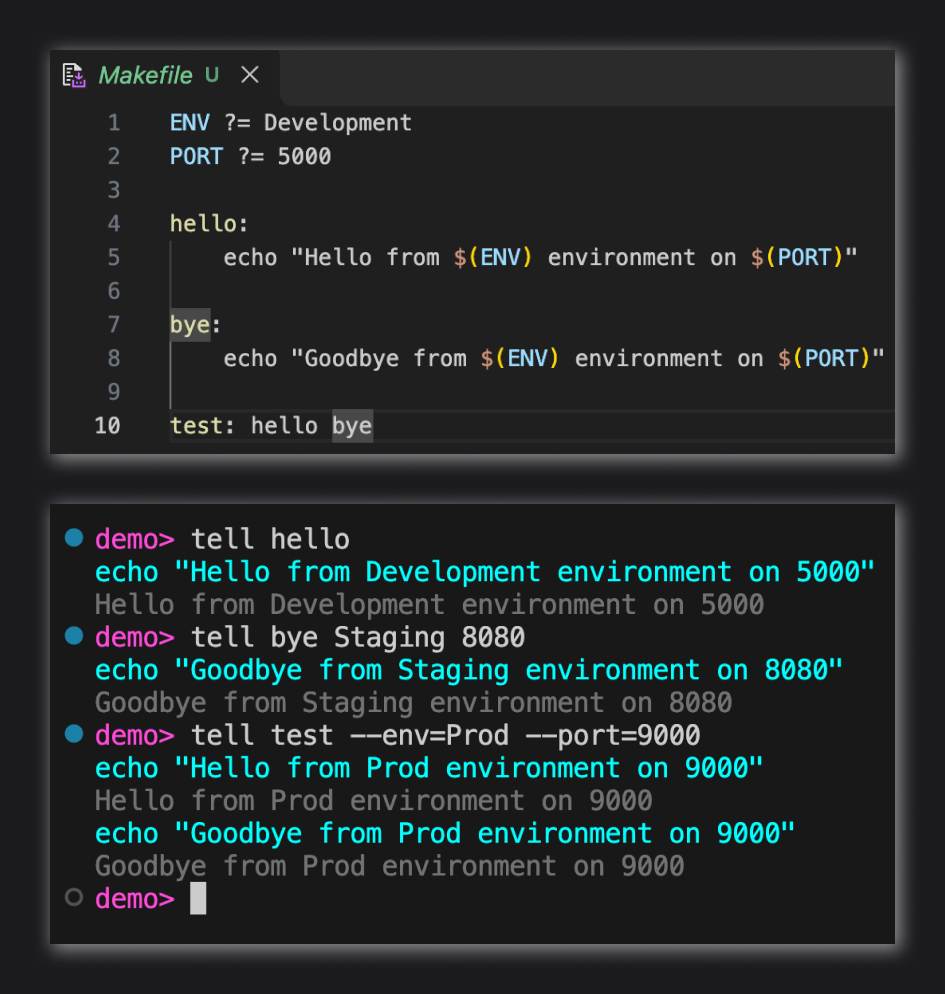

# Tell - Command Runner


Save commonly used commands in a projects `Makefile`. Simply `tell` to execute them by name:



> 🤔 [Why?](#why-do-you-need-a-command-runner) |  [How?](#getting-started)

`tell` is heavily inspired by `make`. In fact, `tell` inherits it's file format from `make`. If you have a `Makefile` already, you can get all the [improvements of tell over make](#comparison-to-make), without changing a line of your `Makefile`.

## Installation

Via dotnet tools:

```sh
dotnet tool install --global Tell.Cli
```

## Why Do You Need a Command Runner?

## Getting Started

## Comparison to Make